### 🚀 Proyectos destacados

| Proyecto | Qué es | Stack |
|---|---|---|
| 🏎️ **Fantasy F1** | App web instalable para seguir la Fórmula 1 (calendario, resultados, mundiales) con un juego de fantasy y notificaciones push. | Next.js · React · Tailwind · Supabase · Vercel |
| 🌊 **Flowly** | App móvil con API propia, tiempo real y reconocimiento de voz, con arquitectura por capas. | .NET MAUI · ASP.NET Core · EF Core · SignalR |
| 🗓️ **Uplan** | App móvil de planificación con mapas, geolocalización y datos offline. | .NET MAUI · SQLite · Supabase |
| 💇 **[Web de peluquería](https://andreabl020.github.io)** | Web para un salón: servicios, galería y reserva de cita. | HTML · CSS · JavaScript |

Algunos proyectos son privados. Si quieres ver el código, ¡escríbeme!
